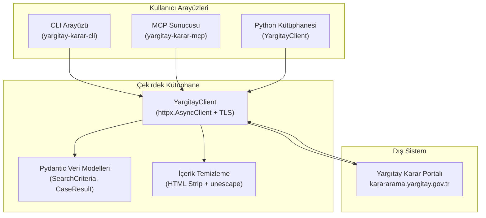
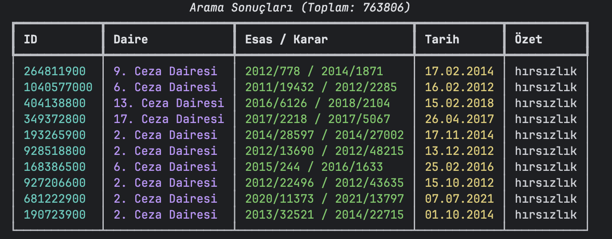
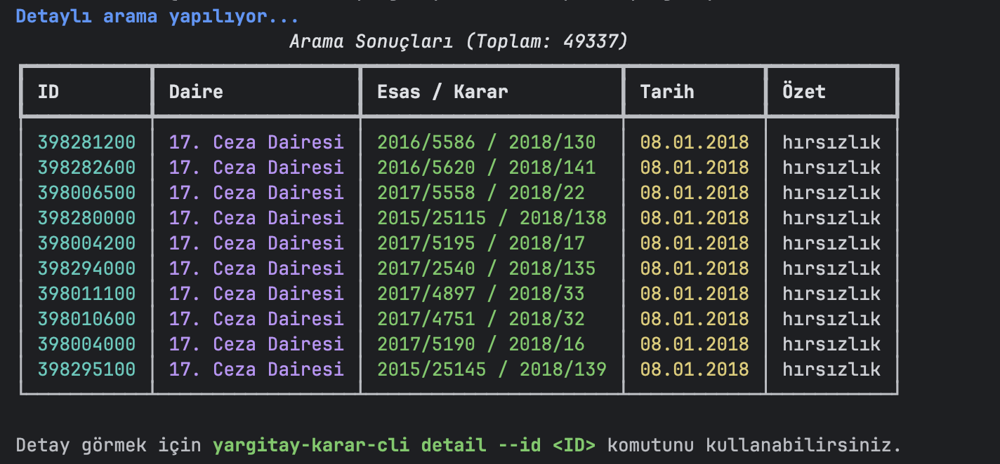
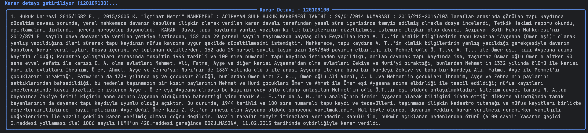

<p align="center">
  
</p>

<h1 align="center">Yargıtay Karar Arama Scraper & MCP Sunucusu</h1>

<p align="center">
  <a href="https://pypi.org/project/yargitay-karar-scraper/">
     <!-- x-release-please-version -->
  </a>
  <a href="https://pypi.org/project/yargitay-karar-scraper/">
    
  </a>
  <a href="https://github.com/AtaCanYmc/yargitay-karar-scraper/actions/workflows/ci.yml">
    
  </a>
  <a href="LICENSE">
    
  </a>
  <a href="https://atacanymc.github.io/yargitay-karar-scraper/">
    
  </a>
</p>

<p align="center">
  Yargıtay Karar Arama portalı için asenkron Python istemcisi, Rich tabanlı CLI arayüzü ve Model Context Protocol (MCP) sunucusudur.<br>
  <strong><a href="https://atacanymc.github.io/yargitay-karar-scraper/">Canlı Dökümantasyon ve İnteraktif Komut Sihirbazı &rarr;</a></strong>
</p>

---

## İçindekiler

- [Genel Bakış](#genel-bakış)
- [Mimari](#mimari)
- [Kurulum](#kurulum)
- [Kullanım](#kullanım)
  - [1. Komut Satırı Arayüzü (CLI)](#1-komut-satırı-arayüzü-cli)
  - [2. Model Context Protocol (MCP) Sunucusu](#2-model-context-protocol-mcp-sunucusu)
  - [3. Python Kütüphanesi Olarak Kullanım](#3-python-kütüphanesi-olarak-kullanım)
- [Arayüz Önizlemeleri](#arayüz-önizlemeleri)
- [Geliştirme ve Test](#geliştirme-ve-test)
- [Proje Dizini Yapısı](#proje-dizini-yapısı)
- [Lisans](#lisans)

---

## Genel Bakış

Bu paket, Yargıtay Karar Arama sistemi (`karararama.yargitay.gov.tr`) üzerinden içtihat araması yapılmasını ve kararların çekilmesini sağlar. Üç farklı arayüz sunar:

1. **Python SDK:** `httpx` ve `pydantic` tabanlı, TLS doğrulamalı asenkron arama istemcisi.
2. **CLI:** `click` ve `rich` tabanlı, sonuçları terminalde formatlanmış tablolarla gösteren komut satırı aracı.
3. **MCP Sunucusu:** LLM ajanlarının (Claude Desktop, Cursor vb.) Yargıtay kararlarını doğrudan sorgulamasına olanak tanıyan `FastMCP` stdio sunucusu.

---

## Mimari

Aşağıdaki şema sistem bileşenlerini ve veri akışını gösterir:



---

## Kurulum

### Homebrew ile Kurulum (Önerilen)

macOS ve Linux üzerinde Homebrew tap aracılığıyla tek komutla kurabilirsiniz:

```bash
brew tap atacanymc/tap
brew install yargitay-karar-scraper
```

### Kaynak Koddan Kurulum

```bash
git clone https://github.com/AtaCanYmc/yargitay-karar-scraper.git
cd yargitay-karar-scraper
pip install -e .
```

### PyPI Üzerinden Kurulum

```bash
pip install yargitay-karar-scraper
```

Geliştirme ve test araçlarıyla birlikte kurmak için:

```bash
pip install -e ".[test]"
```

---

## Kullanım

### 1. Komut Satırı Arayüzü (CLI)

Paket kurulduğunda `yargitay-karar-cli` komutu terminalinizde kullanılabilir hale gelir.

#### Basit Arama (`search`)

```bash
yargitay-karar-cli search --kelime "hırsızlık" --page-size 10
```

#### Detaylı Arama (`detailed-search`)

Daire, karar yılı, esas yılı ve sıralama kriterlerine göre gelişmiş arama yapar:

```bash
yargitay-karar-cli detailed-search --kelime "dolandırıcılık" --daire "11. Ceza Dairesi" --karar-yil "2021"
```

#### Karar Metni Görüntüleme (`detail`)

Arama sonuçlarından elde edilen karar ID değeri ile tam metni getirir:

```bash
yargitay-karar-cli detail --id "120109100"
```

Ayrıntılı CLI seçenekleri için [docs/cli_usage.md](docs/cli_usage.md) kılavuzuna bakın.

---

### 2. Model Context Protocol (MCP) Sunucusu

`yargitay-karar-mcp` komutu standart girdi/çıktı (stdio) üzerinden çalışan bir FastMCP sunucusu başlatır.

#### Sunulan Araçlar (Tools)

| Araç Adı | Açıklama | Başlıca Parametreler |
| --- | --- | --- |
| `search_cases` | Yargıtay sisteminde kriterlere göre detaylı arama yapar. | `kelime`, `daire`, `karar_yil`, `esas_yil`, `page_size` |
| `get_case_detail` | Belirtilen karar ID'sine ait temizlenmiş tam metni getirir. | `document_id` |

#### Claude Desktop Entegrasyonu

Claude Desktop yapılandırma dosyanıza (`claude_desktop_config.json`) sunucuyu ekleyin:

- **macOS:** `~/Library/Application Support/Claude/claude_desktop_config.json`
- **Windows:** `%APPDATA%\Claude\claude_desktop_config.json`

```json
{
  "mcpServers": {
    "yargitay_kararlar": {
      "command": "yargitay-karar-mcp",
      "args": []
    }
  }
}
```

Entegrasyon detayları ve örnek istemler için [docs/mcp_usage.md](docs/mcp_usage.md) kılavuzuna bakın.

---

### 3. Python Kütüphanesi Olarak Kullanım

Asenkron `YargitayClient` sınıfı doğrudan Python uygulamalarına dahil edilebilir.

```python
import asyncio
from yargitay_karar_scraper.scraper import YargitayClient, SearchCriteria

async def main():
    # Varsayılan olarak TLS doğrulaması etkindir (verify=True)
    client = YargitayClient(timeout=30)
    criteria = SearchCriteria(kelime="dolandırıcılık", page_size=5)

    response = await client.search(criteria)

    if response.error:
        print(f"Hata: {response.error}")
        return

    print(f"Toplam Kayıt: {response.total_count}")
    for case in response.results:
        print(f"[{case.id}] {case.daire} - Esas: {case.esas_no}, Karar: {case.karar_no}")

if __name__ == "__main__":
    asyncio.run(main())
```

Çalıştırılabilir ek senaryolar için [examples/](examples/) dizinini inceleyebilirsiniz.

---

## Arayüz Önizlemeleri

<details>
  <summary>Terminal Arayüzü Ekran Görüntüleri</summary>
  <br>
  <table>
    <tr>
      <td align="center">
        <b>Basit Arama Sonucu</b><br>
        
      </td>
      <td align="center">
        <b>Detaylı Arama Sonucu</b><br>
        
      </td>
    </tr>
    <tr>
      <td colspan="2" align="center">
        <b>Karar Detay Görünümü</b><br>
        
      </td>
    </tr>
  </table>
</details>

---

## Geliştirme ve Test

Projeyi yerel ortamda çalıştırmak, lint ve test kontrollerini gerçekleştirmek için:

```bash
# Bağımlılıkları kurma
pip install -e .
pip install flake8 pytest pytest-asyncio

# Linter kontrolü
flake8 . --count --select=E9,F63,F7,F82 --show-source --statistics

# Birim testleri çalıştırma
pytest

# Paket derleme kontrolü
pip install build
python -m build
```

---

## Proje Dizini Yapısı

```text
.
├── .github/
│   └── workflows/
│       ├── ci.yml            # CI test ve linter iş akışı
│       └── publish.yml       # PyPI yayınlama iş akışı
├── docs/
│   ├── cli_usage.md          # CLI komut kılavuzu
│   └── mcp_usage.md          # MCP yapılandırma kılavuzu
├── examples/
│   ├── basic_search.py       # Basit arama örneği
│   ├── detailed_search.py    # Gelişmiş arama örneği
│   └── get_document.py       # Karar metni çekme örneği
├── tests/
│   └── test_client.py        # Asenkron birim testleri
├── yargitay_karar_scraper/
│   ├── cli/
│   │   └── main.py           # Click ve Rich tabanlı CLI
│   ├── mcp/
│   │   └── server.py         # FastMCP stdio sunucusu
│   └── scraper/
│       ├── client.py         # Asenkron HTTP istemcisi (httpx)
│       └── models.py         # Pydantic veri modelleri
├── .flake8                   # Linter kuralları
├── .gitignore                # Git yok sayma kuralları
├── LICENSE                   # Apache-2.0 lisans metni
├── pyproject.toml            # Paket yapılandırması
└── README.md                 # Proje dokümantasyonu
```

---

## Lisans

Bu proje [Apache-2.0](LICENSE) lisansı ile dağıtılmaktadır.
